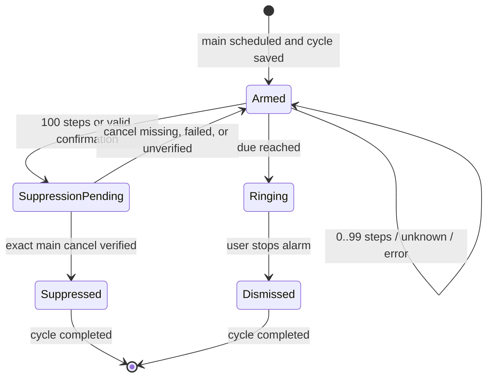

# AlreadyUp 設計

## 1. 目的と安全原則

AlreadyUp は、設定時刻に実際の音を鳴らし、期限前60分以内にアプリを画面に表示したまま歩いた100歩の起床行動、または本人の明示操作を確認できた場合だけ、対応する1周期のアラームを抑止する。

> 起きていると確定できない場合は、アラームを残す。

最重大事故は「本当は寝ているのに、推定や処理失敗によってアラームを止めること」である。誤って鳴ることは許容しても、正の証拠と OS 上の取消確認なしに止めることは許容しない。

## 2. 現行スコープ

### 含む

- 最大10件のアラーム設定
- 今日だけ、毎日、平日、曜日指定
- 設定ごとのオン／オフと削除
- 各設定の先3周期を個別 local notification として予約
- 期限の60分前から、アプリを画面に表示している間だけ数える foreground Pedometer の100歩
- 期限直前の actionable notification
- 対象周期だけを cancel する fail-safe policy
- foreground ループ音
- 就寝時の正式手順（アプリを画面に表示したまま充電）と、鳴動中・24時間以内の監視周期がある間の画面スリープ防止（11.2）
- v1 単一アラーム保存形式から v2 複数形式への移行

### 含まない

- 睡眠そのものの推定
- background での継続的な歩数監視
- AlarmKit / Critical Alerts による鳴動保証
- スヌーズ
- アラーム名、音、振動の編集
- 先3周期をバックグラウンドで永続的に補充する native scheduler
- watchOS 専用アプリ

## 3. データモデル

### 3.1 Alarm definition

```ts
interface StoredAlarmDefinition {
  id: string;
  hour: number;
  minute: number;
  repeat: AlarmRepeat;
  enabled: boolean;
  createdAtMs: number;
  cycles: StoredAlarm[];
}

type AlarmRepeat =
  | { kind: 'today'; weekdays: []; dateKey: string }
  | { kind: 'daily'; weekdays: [0, 1, 2, 3, 4, 5, 6] }
  | { kind: 'weekdays'; weekdays: [1, 2, 3, 4, 5] }
  | { kind: 'custom'; weekdays: Weekday[] };
```

曜日はローカル timezone の `0=日` から `6=土` で保存する。`today` は日付を `YYYY-MM-DD` として固定し、過去時刻を翌日へ繰り越さない。

### 3.2 Alarm cycle

```ts
interface StoredAlarm {
  alarmId: string;
  cycleId: string;
  mainAlarmId: string;
  checkInNotificationId?: string;
  armedAtMs: number;
  dueAtMs: number;
  phase: 'armed' | 'step_candidate' | 'suppressed' | 'ringing' | 'dismissed';
  stepCount: number;
  stepCountFromMs?: number;
  stepCandidateAtMs?: number;
  confirmedAtMs?: number;
  stepCandidateRecorded: boolean;
}
```

`stepCount` は `stepCountFromMs` から数えた歩数である。`stepCountFromMs` がその周期の現在の歩数 window 開始時刻と一致しない場合（旧データで未設定の場合を含む）、保存済み `stepCount` は0として扱う。同じ開始時刻での更新は大きい方を保持し、より後の開始時刻での更新は新しい値で置き換えて `stepCountFromMs` も更新する。`stepCountFromMs` は後ろへしか動かさず、保存済みより前の開始時刻から数えた更新は無視する（`updateMonitoringCycleStepCount` の `stale_window`）。他の周期が停止した時は、重なる周期の `stepCountFromMs` を停止時刻へ進めて `stepCount` を0にする（7.1）。

`alarmId` はユーザー設定、`cycleId` は特定日の特定時刻を識別する。通知 action の `cycleId`、保存済み `mainAlarmId`、check-in request ID の全てが一致しない限り cancel しない。

## 4. 繰り返し計算

`getUpcomingAlarmTimes` はローカル date を1日ずつ進め、repeat rule に一致する未来時刻を最大3件返す。

| repeat | 次回計算 |
|---|---|
| 今日だけ | 保存した当日かつ現在より後だけ。日付は作成時に固定し、オン操作で付け替えない |
| 毎日 | 次に到来する全曜日 |
| 平日 | 月〜金だけ |
| 曜日指定 | 選択した1曜日以上だけ |

### 4.1 時刻の意味（ALR-008）

- 繰り返し（毎日・平日・曜日指定）の `HH:mm` は**端末のローカル壁時計**で解釈する。保存する `dueAtMs` は計画時点のタイムゾーンで確定した絶対時刻であり、タイムゾーンを変えると壁時計と一致しなくなる。
- 「今日だけ」は保存した `dateKey`（元のローカル日付）に固定する。タイムゾーンが変わっても別の日付へ移さない。
- `isDueTimeWallClockAligned` が、保存した `dueAtMs` を計画と同じ構築子でローカル日付の `HH:mm` へ直した値と比べ、ずれた周期を「別タイムゾーンで計画された」と判定する。DST で存在しない時刻は計画側と同じ位置になるため、ずれとは判定しない。
- 計画時のタイムゾーン（IANA 名）を `already-up/planning-zone/v1` に保存する（`src/planningZone.ts`）。ずれの判定は保存値に依存せず、保存値は「タイムゾーンの変更に合わせて組み直した」旨の notice を選ぶためだけに使う。再照合が全件成功したときだけ更新する。
- 手動の時刻変更: 壁時計とのずれ（タイムゾーン変更）は上記の判定で検出する。同じタイムゾーンでの手動変更は保存済み `dueAtMs` が絶対時刻のままなので判定では検出できない。代わりに iOS の予約を絶対 UTC の CALENDAR トリガーにし、OS キューから読み戻した絶対時刻と保存値を照合する（6.1）。実機で手動時計変更後に正しく鳴るかは**未確認**（DEVICE_TEST 16③）。

全て one-off `DATE` trigger とする。同じ recurring request を使わないのは、1周期だけを安全に cancel し、古い応答が将来周期へ波及することを防ぐためである。

## 5. 通知予算

iOS は保留 local notification を直近64件まで保持する。AlreadyUp は次の上限を固定する。

```text
10 alarm definitions
× 3 upcoming cycles
× 2 notifications (main + check-in)
= 60 pending notifications maximum
```

予約枠は JavaScript が動いている間だけ、次の契機で各設定の先3周期（`today` は1周期）まで補充する。

| 契機 | 条件 |
|---|---|
| 起動時の読み込み | 未完了の停止処理を回復できた場合。`prepareNotifications()` で必要なら権限を求める |
| `AppState` が `active` へ変化（読み込み完了後） | Web でない、別の補充が実行中でない、オンのアラームがある、`getPermissionsAsync()` が `granted`。権限 prompt は出さない（`prepareNotificationsIfGranted()`）。停止・オフの journal が残る definition は補充しない |
| アプリ内の起床確認成功・100歩抑止・鳴動停止 | 対象 definition だけ補充する |

起動時と `active` 復帰時は同じ補充処理を使い、補充途中で保存に失敗した場合は今回予約した通知を取り消す（`withScheduledNotificationRollback`）。予約できなかった問題は `kind` と `alarmId` で識別し、前回の補充で報告していない問題がある場合だけ notice を出す（`reconcileReportedScheduleProblems`）。問題が解消すると記録から外し、再発時は再び通知する。各行の予約範囲表示（11章）が状態を示し続けるため、同じ notice を復帰のたびに繰り返さない。

補充のたび（起動時・`active` 復帰時・追加・オン・アプリ内の周期完了後）に、対象にした definition ごとの直近の結果を記録する（`recordRefillAttempt`）。今回の対象は前回の結果を置き換え、対象外の definition は前回の結果を保つ。次の definition を「直近の補充に失敗」とし、11章の行表示へ渡す。

- 補充が問題（`main_schedule_failed` / `check_in_schedule_failed`）を報告した
- 停止・オフの journal が残るため補充しなかった
- 補充が途中で失敗した（起動時の権限拒否、journal の読み取り・保存・rollback の失敗）、または起動時に停止処理を回復できず補充しなかった（対象にしたオンの definition すべて）

`active` 復帰時に権限がなく補充しなかった場合と、別の補充が実行中で見送った場合は記録を変えない（権限がない間は行に通知の警告（11.1）を優先する）。

通知の「起きています」や通知からの停止だけを使い、アプリを前面に戻さない場合は補充されない。アプリを3周期以上開かない場合の継続補充は未実装であり、本番 release gate とする。暫定対策として、繰り返し設定（`today` 以外）の main 通知の本文に「アプリを開くと次回以降の予約を続けます。」を添え、一覧で予約の終わりと残り1周期を警告する。本文は `getMainAlarmNotificationBody`（`src/alarmNotificationContent.ts`）で選び、`AlarmSchedulingGateway.scheduleMain` の `repeats`（`repeat.kind !== 'today'`）で切り替える。先の周期がない `today` には添えない。

## 6. 予約シーケンス

各周期は次の順序で予約する。

1. 入力時刻と repeat rule を検証する。
2. 一意な `cycleId` を作成する。
3. main alarm を OS に登録し、`mainAlarmId` を得る。
4. 最大60秒前の check-in を登録する。
5. definition と cycle を AsyncStorage v2 に保存する。

main を必ず先に登録する。check-in の登録に失敗しても main を残し、警告を返す。main の登録に失敗した周期は「予約済み」と表示しない。

### 6.1 OS キューとの照合（ALR-003 / ALR-008、`src/scheduleReconciliation.ts`）

保存した未来の周期と OS の保留通知を、起動時（`markDueCyclesRinging` の後、補充の前）と `active` 復帰時（補充の前）に照合する。保存済みであることは OS に予約されていることを意味しない。

**決定した順序（決定的）**

1. `suppressionJournal.exclusive`（進行中の停止・回復）→ `transactAlarmDefinitions`（ユーザーの cancel・補充と同じ保存キュー）の順にロックを取り、OS キューは保存キューの順番を得た後に読む。ユーザーの停止は照合の前か後に直列化され、照合が消された通知を作り直すことはない。
2. 照合の対象外: オフの alarm、未完了の cancel journal または suppression journal が残る alarm、`suppressed` / `dismissed` / `ringing` の周期（再作成しない）、期限を過ぎた周期。
3. OS キューを読めない場合は `unknown` とし、何も予約も取消もしない。権限がない場合も同様で、`prepareNotificationsIfGranted()`（prompt なし）が false のとき修復しない。いずれも行に「予約を確認できません」/「通知が端末に見つかりません」を表示し、「…まで予約済み」と表示しない。
4. 別タイムゾーンで計画された周期は、**古い周期を 1 件ずつ**、容量確認（main + check-in の 2 件が空いているか）→ 新規予約 → checkpoint → OS キューを読み直して新しい ID が内容つきで存在することを確認 → 対応する古い周期の正確な ID を cancel → 古い周期を保存から削除、の順で置き換える。古い周期と新しい周期は明示的に対にし（`ReplacementPair`）、途中で止まった後の再実行は既に作った新しい周期を再利用して、2 つ目のコピーを作らない。確認できない（OS が成功を返しても保持していない、読み直せない）間は古い周期を残す。`suppressed` などが占める時刻は空けたままにする。「今日だけ」の元日付・壁時計が既に過去なら、元の予約を残す。新規予約に失敗した場合は古い周期を残す（鳴らないより別時刻に鳴るほうを選ぶ）。確認済みの置換が既にある古い周期は「置換済み」とし、cancel 後の保存に失敗しても main の再作成対象にしない（古い時刻の再作成を防ぐ）。古い周期の期限（`dueAtMs`）に達したら、非同期の修復中でも cancel も削除もせず鳴動経路に任せる。
5. main が OS に無い周期は、まず同じ周期の内容を持つ未追跡の通知（保存前にクラッシュして残ったもの）を採用し、無ければ空きを確認して同じ `cycleId` で main を再予約 → OS キューで内容を確認 → 旧 check-in（旧 main を指す）を正確な ID で cancel → checkpoint → 新 main を指す check-in を再予約（空きを確認）→ 確認 → checkpoint。空きが無く自分の旧 check-in があるときだけ、それを先に cancel して 1 件空ける。
6. check-in だけ無い周期は、確認済みの main を残して check-in だけ再予約する（空きが無ければ `capacity_full`）。check-in の時刻を過ぎている場合は再作成しない。
7. 各 checkpoint の保存に失敗したら、直前に予約した ID を cancel して元の例外を返す。cancel できなかった ID があれば `OrphanStore`（`src/orphanedNotifications.ts`）に永続し、`ScheduledNotificationRollbackError` を返す。次の照合の最初に、その ID が OS キューに自分の内容で残っていれば cancel し、消えている・別内容なら追跡を外す。
8. 照合が途中で例外になった場合、App は caller の古い配列を使わず、`recoverAbortedReconciliation` で保存済みの最新 checkpoint を読み直して App state へ反映する。読み直せなければ `alarms: null` を返し、何も保存済みと主張しない。解除できなかった ID は notice（danger）で知らせる。
9. **補充の可否は `assessReconciledState`（`src/reconcileGate.ts`）が決める**。補充は OS キューも orphan 一覧も読まないため、`freshness: 'fresh'`（保存済み状態を読めた）、OS キューを読めた（`queueVerified`）、中断していない、解除できていない ID が無い、未完了の停止が無い、のすべてを満たす `safeToRefill` のときだけ起動時・前面復帰の補充を行う。満たさないときは補充せず `getSkippedRefillAttempt` で「未補充」と記録し、警告 notice のまま次の起動・前面復帰で再試行する。`stale` の alarms は表示用で、補充には使わない。
10. **orphan の解放は生きている ID に触れない**。`OrphanStore` にある ID でも、保存済みのどの周期の `mainAlarmId` / `checkInNotificationId` にも参照されていれば cancel せず追跡だけ外す。採用（未追跡の同一周期の通知を保存した）時と、旧 ID の cancel 完了時にも追跡から外す。

**容量**: iOS のローカル通知は 64 件までで、Expo Go では他プロジェクトの通知も同じ枠を使う。OS が超過分のどれを捨てるかは仕様で定まっていないため、アプリは外部通知を含む保留件数（`QueueIndex.size`）に必要件数を足して 64 以下のときだけ予約する。足りなければ予約も cancel もせず、古い予約を残して `capacity_full`（「通知の上限に達しており、再予約できませんでした」）を表示する。

**所有の判定と保存済み旧 ID・読めない journal（リセット時）**: 通知の所有は、まず名前空間の印（`owner` など）で厳密に判定する。印のない旧 main は名前空間では見つけられないため、(1) 検証できる保存データ、(2) version 1 として厳密に検証できた orphan journal（`parseOrphanJournal`）に残る正確な ID だけを、リセットの durable intent（`ownedIds`）に先に書いてから解除する。カレンダー移行で保存済み周期が新 ID に変わった後の旧 main も、journal が有効ならここで解除できる。journal が壊れている・別版・不正な ID を含む場合は信頼せず ID を一切使わない: 名前空間の印のある通知だけ解除し、印のない旧通知は残して「判別できない通知」の警告に数える。planning zone（`PLANNING_ZONE_KEY`）も全消去の対象で、無くても問題ない。通常の照合で orphan journal が読めない間（`orphansUnreadable`）は補充を止め（`orphans_unreadable`）、`summarizeReconciliation` が alarm 数に関係なく danger の notice（`queue_orphans_unreadable`）を毎回の未解決問題として出す。OS キューを確認できない（`queueVerified: false`）ときも、「予約済み」とは表示せず警告する（`queue_unverified`）。

**iOS の予約と旧予約の移行**: SDK 57 の iOS は DATE 入力を相対秒の `UNTimeIntervalNotificationTrigger` に変換し、絶対時刻を読み戻せない。そこで iOS だけ文書化された CALENDAR 入力（`timezone: 'UTC'`、year〜second を全て明示、`repeats: false`）で予約する（`src/notificationTrigger.ts`、Android は DATE のまま）。時刻は秒単位で、早く鳴らさないため**秒へ切り上げ**て予約・照合する。読み戻した `dateComponents` / `timeZone`（`UTC` または `GMT`）は全項目の範囲と実在日を検査して絶対 ms にし、欠落・範囲外・別ゾーンの形は `unverifiable`（verified にしない）。旧ビルドが残した相対トリガーの自アプリ通知は `legacy` とし、権限があれば移行する: 空き確認（旧と新が共存するため +1 件、無ければ `capacity_full` で旧を残す）→ 同じ `cycleId` で新 main を予約し読み戻して確認 → 旧 ID を orphan に永続 → 関連付けを checkpoint（`cycleId` / `armedAtMs` / 歩数 / phase を保持）→ 旧 check-in・旧 main を正確な ID で cancel（自分の内容と確認できた場合のみ）→ 新 check-in を再予約。期限に達した・保存失敗・確認失敗のいずれでも旧予約を残す。

**キューの照合は通知の内容で行う**（`src/queueInspection.ts`）: `kind` / `alarmId` / `cycleId` / check-in の `mainAlarmId` が保存値と一致する通知だけを「自分のもの」とする（`alarmId` は契約上 optional なので、明示的な不一致のみ除外）。同じ ID で内容が違う・読めない通知は foreign として触らず、その alarm を `unverified` にする。cancel も、キュー上の内容が自分のものと確認できた ID だけに行う（不在は完了扱い）。トリガー時刻は SDK 57（`expo-notifications` 57.0.23 のネイティブ serializer と型を確認）で、Android は `{ type: 'date', value: <epoch ms> }` として読めるため一致を確認し、不一致なら `unverified`。iOS は DATE 入力が `UNTimeIntervalNotificationTrigger`（予約時点の相対秒）に変換され `{ type: 'timeInterval', seconds }` としてしか読めず、絶対時刻を取得できないため、iOS では時刻は検証せず内容のみで verified とする。

**Rollback / 再入防止**: 実行中の照合は module で 1 つに共有し（`scheduleReconcileInFlight`）、同時の呼び出しは同じ結果を受け取る。再実行は冪等で、2 回目は何も予約しない。cancel は保存した ID のみを対象にし、OS キューにある無関係な ID は触らない。期限に達した周期は修復中も `nowMs()` で再確認し、鳴動経路に任せる。

**結果の表示**: 行ごとに `verified` / `repaired` / `check_in_missing` / `unverified` / `duplicated`（古い予約と新しい予約が両方残り、2 回鳴る可能性）/ `missing` / `capacity_full` を `getScheduleCoverageLine` の `queueStatus` として既存の警告行（11章）に渡す。notice は `summarizeReconciliation` が 1 つ選び、未解決の問題は `alarmId` 単位で 1 回だけ出す。追加・オンにした alarm の状態は予約直後なので消す。

**ゲートウェイ境界**: 照合は `ReconcileGateway`（`scheduleMain` / `scheduleCheckIn` / `cancelScheduled`）と `readQueue`（`QueueInspection`）だけに依存し、`expo-notifications` を直接参照しない。将来の native AlarmKit は別 issue でこの境界の背後に追加できる。

**制限**: アプリが動いていない間（再起動後、通知削除後、時刻変更後）は検知できず、次の起動・前面復帰で照合する。iOS の CALENDAR 予約は絶対時刻を読み戻せる設計だが、Expo Go での読み戻し（`timeZone` の表記を含む）と、手動で時計を変えた後に実際に正時に鳴るかは**実機で未検証**。旧ビルドの相対予約は時刻を検証できないため移行する。64 件超過時の OS の破棄順は実機で未検証で、アプリは超過を避けることだけで対処する。cancel 後に古い周期の削除保存が失敗した場合の「置換済み」は同一プロセス内でのみ記憶し、再起動後は置換先が OS で確認できたときに限り古い周期を削除する（確認できなければ古い周期は壁時計とずれたまま `missing` / `duplicated` と表示される）。

## 7. 起床証拠と抑止

### 7.1 100歩

- foreground で最も近い未来周期だけを監視する。
- 歩数 window（2026-10-05決定）は `startMs` から `dueAtMs` 未満までとする。`startMs = max(dueAtMs - 60分, armedAtMs, floorMs, 保存済み stepCountFromMs)` で、App は `getStepCountingStartMs(alarms, cycle)`（`src/stepWindow.ts`）で求めた時刻から数える。`floorMs` は他の周期（全設定）のうち、まだ保存されている `suppressed` かつ `confirmedAtMs < dueAtMs` の最新 `confirmedAtMs` である。別周期の停止に使った歩数や確認済みの時間帯を再利用しない（例: 06:30 と 07:00 の設定）。
- 床の永続化: 停止済み周期は期限を過ぎると起動時・前面復帰時の補充で整理され、`floorMs` から消える。そのため周期を `suppressed` で保存する同じ mutation（`saveStoredAlarm` → `replaceStoredCycle` → `applySuppressionStepFloor`）で、他の `armed` / `step_candidate` 周期（全設定）のうち `dueAtMs - 60分 < confirmedAtMs < dueAtMs` のものへ `stepCountFromMs = confirmedAtMs`、`stepCount = 0` を書き込む。既に `confirmedAtMs` 以降の `stepCountFromMs` を持つ周期は変更しない。停止後に予約された周期は `armedAtMs` が停止時刻より後になる。例: 06:30・06:40・07:00 の毎日設定で、06:00〜06:10 の100歩が 06:30 を 06:10 に停止した場合、06:30 が整理された後も 07:00 は 06:10 から数える。
- 数えるのは、アプリを画面に表示している間に `watchStepCount` で観測した歩数と、同じ window で保存済みの歩数だけとする（2026-10-05決定）。window 開始前と、アプリが背面にある間（`AppState` が `background`）は Pedometer を購読せず、数えない（`shouldWatchSteps`）。window 中は保存済みの window 歩数を起点に即時に1回評価してから `watchStepCount` の増分を加える。
- iOS の歩数履歴（`getStepCountAsync`）は合算しない。アプリを閉じたまま、または画面をロックしたまま歩いてから再び寝た場合（例: トイレ）に意図せず止めないためで、`NSMotionUsageDescription`（アプリを開いている間の歩数）とも一致する。expo-sensors の iOS 実装は前面復帰時に購読開始時刻から更新を再開し、背面中の歩数も含めるため、背面へ移った時点で購読を外し、前面へ戻ったら保存済み歩数から新しく購読する。
- 99歩以下は main を変更しない。
- 100歩以上でも `armedAtMs <= observedAtMs < dueAtMs` を満たさない場合は拒否する。
- 歩数証拠は数え始めた時刻 `countedFromMs` を持つ。`countedFromMs` が欠落・非有限、`dueAtMs - 60分` より前、`armedAtMs` より前、保存済み `stepCountFromMs` より前（保存値が非有限の場合を含む）、または `observedAtMs` より後の場合は、取消の前に `STEP_COUNT_OUTSIDE_WINDOW` で拒否する（`canSuppressAlarm`）。`processStepThresholdFailSafe` は storage から読み直した周期の `stepCountFromMs` を `AlarmRecord.stepCountFromMs` として渡す。
- 各境界を強制する場所は次のとおり。

  | 境界 | 数え始め（App） | 取消前の拒否 |
  |---|---|---|
  | `dueAtMs - 60分` | `getStepCountingStartMs` | `canSuppressAlarm` |
  | `armedAtMs` | `getStepCountingStartMs` | `canSuppressAlarm` |
  | 保存済み `stepCountFromMs`（永続化した床を含む） | `getStepCountingStartMs` | `processStepThresholdFailSafe` → `canSuppressAlarm` |
  | まだ保存されている他周期の停止時刻 `floorMs` | `getStepCountingStartMs` | 直接は検査しない。停止時に `applySuppressionStepFloor` が重なる周期の `stepCountFromMs` へ書き込むため、上の行で拒否される |
- 保存済み `mainAlarmId` を cancel し、OS pending 一覧から消えたことを確認した場合だけ `suppressed` にする。
- 別設定、別日、次の周期の通知と phase は変更しない（歩数の数え始めだけを上記のとおり後ろへずらす）。

### 7.2 明示確認

check-in notification の「起きています」は、次の全条件を満たす場合だけ有効である。

1. action identifier が `confirm_awake`。
2. kind が `awake_checkin`。
3. cycle、main request、check-in request が保存済み周期と一致。
4. 保存 phase が `armed` または `step_candidate`。
5. 確認時刻が check-in window 内かつ期限前。
6. main cancel 後、OS pending 一覧で消失を確認。

古い通知、default tap、重複 action、期限後 action、取消例外では main を残す。

停止の記録（suppression journal）と復旧:

- 100歩・明示確認とも、cancel の前に意図（`cancelling`）を journal へ記録し、cancel 確認後に `cancelled` へ更新してから `suppressed` を保存する。記録できなければ cancel せず main を残す（`JOURNAL_NOT_WRITTEN`）。同じ周期の記録が残っていれば新しい停止を始めない。
- 停止処理（load・journal・cancel）と起動時・前面復帰時の復旧（`recoverSuppressionJournal`）は、同一プロセス内でだけ `journal.exclusive` により直列化する。別プロセスとの排他はしない。復旧は cancel をせず、記録した正確な ID の周期だけを扱い、補充は未解決の記録がある定義を除外する。
- 永続化した記録の意味は不確実さを含む。`cancelling` のまま残り OS 予約も無い場合は、取り消し済みか発火済みか区別できないため「状態が未確認」とし、鳴る・鳴らないを断定しない。`cancelled` への更新に失敗した場合も同じ扱いになる。

## 8. 状態遷移



期限と証拠が同時に競合する場合はアラームを優先する。

### 8.1 見逃した周期（Issue #17）

- 復旧猶予は期限から 30 分（`RECOVERY_WINDOW_MS`、境界ちょうどは鳴動）。起動・前面復帰・1 秒 tick で未処理の期限超過周期を検出したとき、猶予内なら `ringing`、超過なら無音の `missed` にする（`src/missedAlarms.ts`）。遅れから起床を推定しない。
- すでに鳴動中（`ringing`）の周期は、経過時間だけでは止めない。停止操作でのみ `dismissed` になる（スヌーズは未実装）。
- 起動時のみ、保存済み `ringing` で期限から 30 分超のものを `missed` に移す（前プロセスの音は残っていないため）。30 分以内なら鳴動を継続する。
- `missed` は日付・時刻付きのカードに表示し、「すべて確認済みにする」で該当周期だけを `dismissed` にする。有効な繰り返し定義は有効のまま、既存の補充処理が次回分を維持する。
- 物理端末（実機の通知・音・VoiceOver・最大文字サイズ）での確認は未実施。

## 9. 複数アラーム操作

### オフ

definition が持つ check-in と main を個別に cancel し、OS pending 一覧で消失を確認する。成功後に `enabled=false`、`cycles=[]` を保存する。確認できなければ設定を変更せずエラーを表示する。

### オン

repeat rule から先3周期を再計算し、新しい cycle ID と notification ID を発行する。過去になった「今日だけ」は再利用せず、新規作成を求める。一覧の行には元の日付と「終了」を表示（accessibility label も同じ）し、終了済みでオフの定義は Switch を無効にして、編集・オンで別の日付へ移せないようにする（`prepareAlarmEnable` / `describeTodayOnlyExpiry`）。自動で翌日へ繰り越さず、「Once」へ改名もしない。

### 削除

確認ダイアログ後、対象 definition の通知だけを解除する。解除成功後に definition を削除する。

### 鳴動停止・起床確認後

`today` は無効化する。繰り返し設定は完了周期を残りの周期と区別し、予約枠を最大3件へ補充する。

## 10. 保存と移行

- v2 key: `already-up/alarm-definitions/v2`
- legacy key: `already-up/active-alarm/v1`
- v2 は `{ version: 2, alarms }` として保存する。
- ID 重複、時刻範囲、repeat rule、cycle shape、最大10件を load / save の両方で検証する。`stepCountFromMs` は任意項目で、存在する場合だけ有限の数値であることを検証する（未設定の旧データは有効）。
- 全ての read-modify-write は直列 mutation queue 内で最新値を読み直し、通知応答・歩数更新・画面操作・起動時補充が互いの保存結果を古い snapshot で上書きしない。
- v2 が存在せず valid な v1 がある場合、`today` definition 1件へ移行し、v2 保存成功後に v1 key を削除する。
- malformed data では推測復旧せず、予約済み通知を勝手に解除しない。
- 読めない保存データからの脱出は、失敗カード（`loadFailed`）上の「通知を解除してリセット」だけから、2回の確認（`Alert` 2連続）を経て実行する。起動・前面復帰・通知応答・補充などの自動経路は保存データも通知も消さない（`tests/appWiring.test.ts`）。
- リセットは再利用できる `createStorageResetService`（`src/storageReset.ts`）が行う。`cancelAllScheduledNotificationsAsync` は使わない（Expo Go は他プロジェクトの通知と同じ予約キューを共有する）。解除対象は、新規予約の payload に付く固定マーカー `owner: 'already-up/v1'` に加え、kind ごとの必須 ID（main は alarmId・cycleId、check-in は alarmId・cycleId・mainAlarmId・category）が揃う通知（`isOwnedAlarmNotification`）と、単独で検証に通った保存元（definitions v2、legacy、suppression journal）の正確な ID だけ。壊れた JSON から ID を推測しない。
- **互換性の制限**: マーカー導入前に予約された通知は payload だけでは他の Expo Go プロジェクトの通知と区別できない。保存済みの正確な ID（definitions・legacy・suppression journal・中断した intent）が読める場合に限り解除し、それ以外の契約形式の通知は kind/title だけで解除せず「判別不能」として残す。通知応答（action）の解釈はマーカーなしでも従来どおり受け付ける。
- reset は `{ ambiguousCount }` を返す。1件以上残る場合は「判別できない古い通知が残り、鳴る場合がある」という警告を表示し、`already-up/storage-reset-limitation/v1` に記録して再起動後も起動時に再確認・再表示する（残りが0件になれば自動で消す）。判別不能な通知は保存データの回復と新規アラームの追加を妨げない。
- 手順は、①`already-up/storage-reset-intent/v1` に意図と既知 ID を保存、②該当通知を ID 指定で解除、③予約キューを再取得して残りがないことを確認、④definitions・legacy・cancellation journal・suppression journal を削除、⑤最後に intent を削除。解除を確認できなければ保存データと intent を残して失敗を返す。intent が残る間は起動時も失敗カードを維持し、利用者が再試行する（自動再開しない）。
- reset は suppression journal の排他 → `runExclusiveAlarmStorage`（definitions と cancellation journal のキュー）の順で直列化し、停止・追加・補充と同時に走らない。

## 11. UI 契約

- 上部はブランド、画面タイトル、追加ボタンだけにし、prototype / presentation 表示を置かない。
- 次回アラームは時刻、日付、残り時間を表示する。歩数 window 開始前は進捗barを出さず「起床確認は HH:MM から」「アプリ表示中に100歩」と開始時刻を示し、window 中だけ「起床確認 N / 100歩」と進捗barを表示する。進捗は現在の window で数えた歩数だけを使う。
- 通常文字サイズでは有効時 / idleのsummary cardを同じ140pt固定高とし、一覧の開始位置を動かさない。Dynamic Typeのアクセシビリティscroll時だけ、文字を切らないため同じ140pt最小高から内容に応じて拡張する。
- 設定一覧は時刻、repeat label、次回日付、toggle、予約範囲、削除を表示する。予約範囲は `describeScheduleCoverage`（`src/scheduleCoverage.ts`）で、未来の `armed` / `step_candidate` 周期だけから求める。

  | `describeScheduleCoverage` | 行の表示 |
  |---|---|
  | `off`（オフ） | `通知は予約されていません` |
  | `none`（オンだが未来の監視周期がない） | `予約がありません`（警告色） |
  | `scheduled`（`isRunningLow = false`） | `{最後の周期の日付}まで予約済み`（例: `10/7(水)まで予約済み`） |
  | `scheduled`（`isRunningLow = true`。`today` 以外で残り1周期以下） | `{日付}まで予約済み・アプリを開くと先の分を予約します`（警告色） |
  | 上と同じで、直近の補充に失敗（5章。`getScheduleCoverageLine` の `refillFailed`） | `{日付}まで予約済み・先の分を予約できませんでした`（警告色）。アプリを開いていても補充できないため、開くよう促さない |

  日付は次回アラーム card と同じ `M/D(曜)` 形式とする。通知配送の警告中（11.1）は、オンの各行で予約範囲の代わりに配送できない理由を同じ警告色で表示する。
- メイン画面は通常文字サイズでは外側を `View` として viewport 内に固定し、ページ全体をスクロールさせない。アラーム一覧だけを独立した `ScrollView` とし、件数が増えた場合もヘッダー、次回アラーム、追加導線、一覧panelの丸い下端をviewport内へ固定する。
- Dynamic Type の `fontScale > 1.3` では情報欠落を避けるアクセシビリティ例外として外側スクロールを許可し、通常文字サイズでは一覧以外を固定する。
- 追加フォームはメイン画面の layout tree に挿入せず、背景を blur する `Modal` 上のサブ画面として表示する。タイトル直下の「時刻」「繰り返し」で内容を分け、選択中のglass lensをspring移動させる。通常端末（高さ700pt以上、幅360pt以上、`fontScale <= 1.3`）はsheet高を固定して内部スクロールを無効化し、繰り返しと100歩の説明も1画面内で操作できる。小さい画面・狭い画面・大きい文字では情報欠落を避けるためフォーム本体だけを内部スクロールし、repeat labelは2行まで許可する。
- 時刻設定の標準操作はnative pickerとする。iOSは「時刻」内の先頭に`display="spinner"`の216pt wheelを常時表示し、選択帯を含めて角丸surface内にclipする。Androidは公式推奨のimperative APIで`display="clock"` dialogを開く。選択時刻と`数字で入力`はpicker後段のsecondary controlとし、表示時刻をタップした場合だけ時・分のnumeric keyboard inputへ切り替える。入力は`0..23` / `0..59`を確定時に検証し、不正値では親のalarm stateを更新しない。編集中はpickerを閉じて追加CTAと「繰り返し」切替を無効化する。`fontScale > 1.3`では横並びcopyを縦積みにする。
- 状態通知はstatus barの下、brand rowより上のabsolute overlay layerへspring表示し、メインlayoutを押し下げない。上端のdrag handleでgestureを示し、閉じるbuttonに加えて、上方向へ32px以上または十分な上向き速度でswipeするとdismissし、未達gestureは元の位置へ戻す。Reduce Motion時は自動springを無効化する。
- 追加エラーはスクロール領域外の固定footerに表示し、custom曜日未選択のようなdisabled理由は表示中のtabにかかわらず常時示す。dangerはassertive、その他の状態通知はpoliteとしてassistive technologyへ通知する。ただし頻繁なalarm toggleは完全成功時のbannerを出さない。例外による失敗はdanger、アラーム本体を保存できても一部の起床確認通知を予約できなかった場合だけwarningを表示する。追加処理中はtab、picker、repeat、曜日、確定操作をすべて無効化する。
- iOS 26 以降は `expo-glass-effect` の native Liquid Glass を使う。旧iOSとWebは `expo-blur`、Androidは既存UIの見た目と負荷を維持するため、SDK更新後も半透明 surfaceへfallbackする（`blurMethod="none"`）。Reduce Transparency 有効時はsemantic stateを保った不透明度の高い surface に切り替える。
- Glassは背景写真と操作面の関係を示す上部summary、追加、通知、時刻編集、選択lens、確定へ限定する。alarm list panelと各alarm cardは読みやすいstandard materialを維持し、大面積の背景全体を一律に透明化しない。
- 追加フォームの「時刻／繰り返し」とrepeat controlは、それぞれ1つのglass lensを選択肢間でspring移動させ、単なる背景色の切替にしない。native GlassView自体のopacityはanimateせず、wrapperのgeometryを移動する。Reduce Motion時は選択位置を即時更新する。
- Glass surface 上でも本文・操作のコントラストを維持し、tintは主操作・選択・statusの意味がある箇所だけに使う。glass-on-glassを避ける。
- ホーム背景は端末のローカル時刻とtimezoneだけから決定し、同一の湖畔景観をphotorealisticに生成した夜明け、昼、夕暮れ、夜の4 assetを連続cross-fadeする。基準の日の出は06:00、日の入りは18:00とし、codeで星、太陽、月、山を描くillustration layerは使わない。背景はdecorativeとしてaccessibility treeから除外し、上部scrimでstatus barとheaderの白文字contrastを維持する。
- 背景assetのopacity計算は純粋関数に分離し、任意時刻で隣接する最大2 assetだけを合計opacity 1でblendする。React Nativeの`Image`もopacityが0より大きい最大2枚だけをmountし、4枚同時decodeを避ける。位置情報、国籍、networkは現行モデルへ入力しない。実地点・季節の日の出時刻を使う拡張は、任意の位置情報権限、手動地域設定、privacy copyを別途承認してから追加する。
- Web は UI smoke test とし、通知操作を disabled にする。

### 11.1 通知配送状態

アプリが画面に表示されていない間（閉じている・画面ロック・ほかのアプリが前面。background / terminated）にアラームを鳴らせるのは OS の local notification だけであるため、通知権限から配送状態 `NotificationDeliveryState` を判定し（`src/notificationDelivery.ts`）、鳴らない可能性がある間は「設定済み」に見える表示をしない。判定できない場合は `unknown` とし、`ok` とみなさない。

| `getPermissionsAsync()` の結果 | 状態 |
|---|---|
| 結果なし（`null` / `undefined`） | `unknown` |
| iOS `status` 0（NOT_DETERMINED）/ 1（DENIED） | `off` |
| iOS `status` 3（PROVISIONAL。通知センターへ静かに配送） | `silent` |
| iOS `status` 2（AUTHORIZED）/ 4（EPHEMERAL）かつ `allowsSound === false` | `silent` |
| iOS `status` 2 / 4（上記以外） | `ok` |
| iOS `status` がそれ以外の値 | `unknown` |
| `ios` なし（Android） | `granted` なら `ok`、それ以外は `off` |
| 取得時の例外 | `unknown` |

確認のライフサイクル:

| 契機 | 動作 |
|---|---|
| 起動直後（読み込み完了前） | 状態は `null`（未確認）。警告しない |
| 起動時の読み込み完了後 | `getPermissionsAsync()` で確認する（prompt は出さない） |
| `AppState` が `active` へ変化 | 再確認する。設定アプリから戻った時の復旧と、設定後の無効化を検知する |
| アラームの追加・オン/オフ操作の終了後 | 成功・失敗とも再確認する（権限 prompt の結果を反映） |
| Web | 確認しない（`null` のまま） |

警告は「状態が `ok` 以外」かつ「オンのアラームが1件以上」の場合だけ表示する（`shouldWarnNotificationDelivery`）。

| 状態 | summary card（鳴動中でない場合） | オンの各行 |
|---|---|---|
| `ok` | 通常の次回アラーム / idle card | 予約範囲（11章。例: `10/7(水)まで予約済み`） |
| `off` | 「通知がオフです」「通知がオフのため、次のアラーム {日付} {時刻} は、アプリを画面に表示したままにしていないと鳴りません。」 | `通知オフ・アプリ表示中のみ鳴ります` |
| `silent` | 「通知の音がオフです」「通知の音がオフのため、次のアラーム {日付} {時刻} は、アプリを画面に表示したままにしていないと音が出ません。」 | `通知音オフ・アプリ表示中のみ音が出ます` |
| `unknown` | 「通知の状態を確認できません」「…鳴るか確認できません。」 | `通知の状態を確認できません` |

- 警告 card は次回アラーム card を置き換える danger 状態であり、閉じられない。配色は鳴動 card の danger tone を流用し、Dynamic Type で文言を切らないため140pt最小高から拡張する。
- 次回周期がない場合（オンだが予約なし）も、日付を除いた文言で警告する。
- `設定を開く`（`accessibilityRole="button"`、44pt以上）は `Linking.openSettings()` を呼ぶ。Expo Go では Expo Go の設定画面が開く。失敗時は danger notice を出す。
- 通知なしで鳴らせるのは端末内ループ音だけであり、ループ音は期限の時点でアプリが画面に表示されている間にしか鳴り始められない（`ringing` への移行と再生開始は JS の1秒 tick で行うため、アプリを閉じている・画面ロック中・ほかのアプリが前面の間は鳴り始めない。11.2）。一度鳴り始めたループ音は `setAudioModeAsync({ shouldPlayInBackground: true })` により background でも継続する設定とする。`expo-audio` config plugin の `enableBackgroundPlayback`（UIBackgroundModes への `audio` 追加）は prebuild / development build でのみ反映され、App Store 版 Expo Go では Expo Go 本体の Info.plist に依存する（Expo Go 57.0.9 の bundle は UIBackgroundModes に `audio` を含む）。画面ロック・アプリ切替の後も鳴り続けるかは Expo Go 実機で未確認（BED-08）。そのため `off` / `silent` の文言は「アプリを画面に表示したままにしていないと」鳴らない（音が出ない）、行は「アプリ表示中のみ」とし、「アプリを閉じていると」に限定しない。表示中は鳴るため、常に鳴らないとも表示しない。
- 鳴動中は鳴動 card を優先し、各行の警告だけを表示する。
- 配送状態はアラーム周期の状態を変更しない。`off` でも予約・保存済み周期を解除しない。

### 11.2 就寝時の表示と画面スリープ防止（2026-10-05決定）

Expo Go 配布のままでは、アプリを閉じる・画面がロックされると、アラームは main 通知の通知音1回だけになり、ループ音と歩数確認は動かない。owner 決定（2026-10-05）により、当面は「アプリを画面に表示したまま充電して寝る」ことを正式手順とし、監視中は画面を消さない。本番は自前ビルド（native alarm / AlarmKit 等）へ移行する（ALR-001）。配布方式と native config は変更しない。

画面スリープ防止の条件は純粋関数 `shouldKeepScreenAwake(alarms, nowMs)`（`src/bedsideMode.ts`）で判定する。

| 状態 | 画面を消さない |
|---|---|
| いずれかの周期が `ringing`（定義の `enabled` は問わない。鳴動 card とループ音が `enabled` に依存しないため） | する |
| オンの定義に `armed` / `step_candidate` 周期があり、`dueAtMs <= now + 24時間`（`KEEP_AWAKE_LOOKAHEAD_MS`。ちょうど24時間後を含む） | する |
| 上記のうち期限を過ぎた監視周期（1秒 tick で `ringing` へ移る直前） | する（移行前に画面が消えてアプリが止まるのを防ぐ） |
| オンの監視周期が24時間より先だけ、オフの定義だけ、停止済み（`suppressed` / `dismissed`）周期だけ、アラームなし | しない（端末の自動ロック設定に従う） |

ライフサイクル（`App.tsx`）:

- 条件が true かつアプリが前面にある間だけ `activateKeepAwakeAsync('already-up/bedside')` を呼び、条件が false になった時・前面でなくなった時・unmount 時に同じ tag で `deactivateKeepAwake` を呼ぶ。他の keep-awake 利用（Expo の開発用 tag など）とは tag で分離する。
- 開発モード（`expo start` の dev bundle）では、Expo の `registerRootComponent` が `withDevTools` 経由で `useKeepAwake(ExpoKeepAwakeTag)` をセッション全体で有効にする。tag が別なので bedside の解除はこれを解除せず、上の条件に関係なく画面は消えない。条件どおりの動作は production の JS bundle（`npx expo start --no-dev --minify` を Expo Go で読み込む）でだけ確認できる（BED-05）。
- 前面の判定は `isForegroundAppState`。`background` だけを前面外とし、`active`、`inactive`（iOS の Control Center 表示・着信 overlay 中など）、読み取れない状態は前面とみなす。誤って画面を消すより、画面を点けたままにする方を安全側とする。`active` に戻るたびに再取得する。
- Web では呼ばない。activate の失敗はアプリを止めず、warning notice `getBedsideGuidance(配送状態).keepAwakeFailure`（下の就寝案内の表）を表示する。文言は失敗した時点の最新の配送状態で決め、配送状態の変化で keep-awake を掛け直さない。deactivate の失敗は無視する。
- 画面の明るさは変更しない。手動ロック、ほかのアプリへの切替、着信などによる中断は防げない。

就寝案内 footer:

- 文言は純粋関数 `getBedsideGuidance(配送状態)`（`src/bedsideMode.ts`）で決め、footer・追加フォームの100歩の説明（2行をつないだ1行）・keep-awake 失敗 notice に同じものを使う。
- 1行目は常に「寝るときはアプリを画面に表示したまま充電してください」（12pt / 700）。「開いたまま」は習慣で画面をロックした後も満たしていると読めるため使わない。
- 2行目（11pt / 600）は画面ロックとアプリを閉じることの両方を挙げ、配送状態（11.1）に応じて届かない通知音を約束しない。配送状態だけで決め、オンのアラームの有無には依存しない（これから追加する人にも正しい）。未確認（`null`。Web では常に `null`）は確認前に通知音を約束しないため `unknown` と同じにする。11pt 未満にしない。

| 配送状態 | 2行目 | keep-awake 失敗 notice |
|---|---|---|
| `ok` | 画面ロック・アプリを閉じると通知音1回だけ・歩数確認なし | 画面を点けたままにできませんでした。画面が消えるとアラームは通知音1回だけ・歩数確認なしになるため、端末の自動ロックをオフにしてください。 |
| `off` | 画面ロック・アプリを閉じると鳴りません | 画面を点けたままにできませんでした。画面が消えるとアラームが鳴らないため、端末の自動ロックをオフにしてください。 |
| `silent` | 画面ロック・アプリを閉じると音が出ません | 画面を点けたままにできませんでした。画面が消えるとアラームの音が出ないため、端末の自動ロックをオフにしてください。 |
| `unknown` / 未確認（`null`） | 画面ロック・アプリを閉じると鳴るか確認できません | 画面を点けたままにできませんでした。画面が消えるとアラームが鳴るか確認できないため、端末の自動ロックをオフにしてください。 |

- 配置: footer は `ScreenFrame`（通常は固定レイアウト、`fontScale > 1.3` では画面全体がスクロール）の外に置き、`SafeAreaView` の最下部（下端の safe area の上）に flex の兄弟要素として固定する。スクロール位置・文字サイズ・画面高（iPhone SE の667pt を含む）にかかわらず初期表示で見える。絶対配置で重ねず、footer の高さはコンテンツ領域から差し引かれるため、操作要素を覆わない。通常は `flex: 1` の一覧 panel が縮み（一覧は内部スクロールで全件に到達できる）、`fontScale > 1.3` では footer より上のスクロール領域が縮む。幅は `screen` と同じ最大620pt・左右16pt。
- footer 全体を1つの accessibility 要素とし、2行をつないだ label を読み上げる。`allowFontScaling` を有効にし、`maxFontSizeMultiplier` は2とする（固定表示のため、最大の文字サイズでもスクロール領域を大きく残す）。幅が足りない場合は省略せず折り返す。
- 背景写真の上に自前の backdrop（`rgba(6, 21, 45, 0.86)`、角丸12pt）を敷き、文字は `#FFFFFF` / `#C5CDD8` とする。写真が白・黒のどちらでも 4.5:1 以上のコントラストを保つことを unit test で確認する（`BEDSIDE_FOOTER_COLORS`）。

### 11.3 実機テスト前の既存デザイン修正（2026-10-15）

新しい画面や外観は追加せず、既存の card・行・フォームの挙動と文言を直した。判定は `src/homeStatus.ts` の純粋関数で行う。

- 鳴動中（`isAlarmListLocked`）は一覧のスイッチと削除を無効にし、一覧を薄く表示して読み上げ対象から外す。繰り返しの全周期をここから誤って取り消さないため。
- 鳴動 card は見出し「鳴っています」、停止ボタン「アラームを止める」（56pt以上。起床確認ではなく音を止める操作）。鳴り始めに停止ボタンへ VoiceOver フォーカスを移す（300ms 後。追加画面が開いていた場合は閉じた後。iOS は onDismiss の100ms 後、ほかは700ms 後）。別の読み上げ（announce）は行わず、フォーカスが当たった停止ボタンの label「7時0分のアラームが鳴っています。アラームを止める」（`getRingingStopA11yLabel`）が読まれる。実機の VoiceOver では未測定。
- 停止済みで期限前の回は、card 下と該当行に「10/3(土) 07:00 は100歩（または通知）で起床確認済みのため鳴りません」を表示する（`describeSuppressedOccurrence`。`stepCandidateRecorded` で理由を分ける）。
- 歩数が使えない（端末にない・拒否・エラー）ときは進捗barと「n / 100歩」を隠し、「歩数による停止を確認できません。予定を確認してください」を表示する（先頭に「この端末では歩数を使えません。」「歩数の利用が許可されていません。」「歩数を計測できません。」のいずれかが付く）。通知配送や停止の保存が不明な場合もあるため、アラームが鳴るとは約束しない。拒否時だけ「設定を開く」。この間 card は最小140ptから内容に応じて伸びる（`getStepGuidance`）。
- 保存データを読み込めない場合（`loadFailed`）は通常の空状態や「次のアラームはありません」を出さず、閉じられない danger card と一覧の説明を表示し、＋を無効にして理由を読み上げに含める。カード末尾に、再起動でも直らない場合の最後の手段として「通知を解除してリセット」（44pt以上、折り返し可）を置く。処理中は無効化し、失敗時もカードを維持し、一部がすでに消えている場合があること・再実行で続きから再開することを通知する。成功すると＋が有効になる。バナーは使わない（次の操作で消えるため）。
- 追加フォームは全タブ共通で「平日・初回 10/5 07:00（2日9時間後）」を追加ボタン上に表示し、24時間より先は注意色にする（`summarizeNewAlarm`）。追加成功バナーにも初回日時を入れる。
- 最大文字サイズ: 画面名・時刻（card・一覧・鳴動）は1行で自動縮小し、＋は文字拡大しない。鳴動 card の補足文は時刻と重ならない通常の並びにした。
- 小さい文字の色は `HOME_COLORS`（`src/ui/tokens.ts`）に集約し、`tests/homeContrast.test.ts` で白・黒の背景写真上でも 4.5:1（進捗barは 3:1）を固定する。native Liquid Glass 表示の実測はできていない。

### 11.4 設定・データとプライバシー（Issue #21、2026-10-15）

**設計ターゲット（実装前に確定）。** 新しい外観や素材は作らない。視覚の基準は既存の `App.tsx` のヘッダー行、`AlarmComposerModal` の sheet（`modalRoot` の薄い暗幕、白い角丸 sheet、見出し＋閉じる行、`GlassSurface` の丸い閉じるボタン）、`GlassSurface` とする。Product Design の get-context は親が事前実行済みで、本変更はその結果（既存デザインを守る）に従う。このセッションで公式 skill を別途実行してはおらず、新規の画像・ブランド・アイコン素材も生成していない。

**選定した案。**

| 案 | 内容 | 採否 |
| --- | --- | --- |
| A | ヘッダーの＋の隣に小さな設定ボタンを置き、composer と同じ見た目の sheet（`SettingsModal`）を開く | **採用** |
| B | 一覧の末尾に常設のデータ削除ボタン | 不採用。鳴動停止・アラーム一覧より目立ち、誤操作しやすい |
| C | 専用のフルスクリーン画面を追加 | 不採用。既存にない画面遷移を新設する |

- 設定ボタンは＋と同じ 52pt のガラス円（最小44pt以上）。ラベルは「設定とプライバシー」、ロール button。グリフは文字「⋯」（新規アイコン素材なし）。拡大しない。
- `SettingsModal` は再利用できる枠（タイトル、閉じる、スクロール本文、`children` 差し込み口）。後続の背景・言語設定は同じ枠へ足す。今回は無関係な設定を置かない。
- 本文は `SafeArea` を避けた `ScrollView`。最大文字サイズでも「閉じる」と削除ボタンに届く。削除ボタンは 44pt 以上で折り返し可。
- 先頭にプライバシー要約（保存する項目・保存先・外部送信しないこと）、続けて「データの削除」。詳細は `docs/PRIVACY.md`。
- 削除は native `Alert` の2段階確認。鳴動中は sheet を開かず設定ボタンも無効にする（停止ボタンと一覧の優先順位を変えない）。鳴動はこの sheet より優先し、開いている間に鳴り始めたら sheet を閉じる。
- 削除の失敗時は画面上のアラームを書き換えない（保存側は一部がすでに消えている場合がある）。その旨と、再実行で続きから再開すること、削除が終わるまでアラームの追加・変更ができないことを sheet 内に残す。再起動後は未完了の削除意図が残るため、既存の復旧カードから続行する。自動では削除しない。
- 既存の「通知を解除してリセット」（保存読込失敗カード）は同じ `createStorageResetService` を使い、挙動を変えない。

## 12. Platform 制約

| 制約 | 現行動作 |
|---|---|
| Pedometer background 非対応 | 起床確定にせず main を残す |
| 歩数監視 window（2026-10-05決定） | 最も近い未来周期を、期限の60分前からアプリを画面に表示している間だけ監視し、その間に歩いた分だけ数える。前夜・日中の歩数、他周期の停止に使った歩数、アプリを閉じている間・背面にある間の歩数（iOS の歩数履歴を含む）は数えない。確認できなければ main を残す |
| アプリを閉じる / 画面ロック（Expo Go） | main 通知の通知音1回だけ。ループ音・歩数確認なし。就寝時はアプリを画面に表示したまま充電する手順とし、表示中は鳴動中・24時間以内の監視周期がある間だけ画面を消さない（11.2）。手動ロック・アプリ切替は防げない |
| 通知権限拒否 | 新規アラームを追加しない。既存のオンのアラームは解除せず、summary を閉じられない警告へ置き換え、各行に通知オフを表示する（11.1） |
| 通知音オフ / provisional | 予約は維持し、`silent` 警告を表示する（11.1） |
| 消音スイッチ / 音量 / Focus / Android の channel 単位の音設定 | 検出しない。`ok` 表示でも鳴動保証はない |
| check-in 登録失敗 | main を残し警告 |
| main 登録失敗 | 周期を保存しない |
| cancel 未確認 | `suppressed` にしない |
| Focus / 消音 / 音量 | 鳴動保証なし。release gate で扱う |
| app terminated 時の action | JS handler 不実行の可能性。main が残る安全側 failure |
| 3周期を越える未起動 | 追加周期が補充されない |
| production app identity 未確定 | `app.alreadyup.prototype` を維持し、人間承認なしに app identity を変更しない |
| Web native time picker非対応 | dialはExpo Go実機で使用する旨を表示し、UI / bundle smokeだけ行う |

## 13. Verification matrix

| ID | シナリオ | 期待結果 |
|---|---|---|
| POL-01 | 99歩 | 対象 main を維持 |
| POL-02 | 期限前100歩 + cancel verified | 対象周期だけ suppress |
| POL-03 | 期限時100歩 | main 優先 |
| POL-04 | 古い cycle action | 現周期を維持 |
| POL-05 | 前夜21:00から数えた100歩で07:00を評価 | `STEP_COUNT_OUTSIDE_WINDOW` で main を維持 |
| POL-06 | 06:00（60分前ちょうど）から数えた100歩 | 07:00 周期だけ suppress |
| POL-07 | window 開始の1ms前から数えた歩数、または翌日周期へ同じ歩数を適用 | 拒否して main を維持 |
| POL-08 | window 内に予約された周期 | `armedAtMs` から数え、それより前の歩数は拒否 |
| POL-09 | 06:30 を 06:10 に停止した後の 07:00 | 06:10 以降の歩数だけを数える |
| POL-10 | window 開始と異なる `stepCountFromMs` の保存歩数 | 0 から数え直す。同じ開始時刻なら大きい方を保持 |
| POL-11 | window 開始前 | Pedometer を購読せず、開始時刻を表示する |
| POL-12 | 06:30・06:40・07:00 の毎日設定で 06:30 を 06:10 に停止し、06:30 が整理された後の 07:00 | 07:00 の `stepCountFromMs` は 06:10 のまま。06:00 から数えた歩数は拒否 |
| POL-13 | 保存済み `stepCountFromMs` より前から数えた100歩 | `processStepThresholdFailSafe` が取消前に `STEP_COUNT_OUTSIDE_WINDOW` で拒否。進捗保存も `stale_window` で無視 |
| POL-14 | window 中にアプリを背面へ移す・閉じてから歩き、戻る | 背面へ移った時点で購読を外し（`shouldWatchSteps`）、戻った後は保存済み歩数から数える。背面中の歩数と iOS の歩数履歴は数えない（実機検証は未実施） |
| REP-01 | 毎日 | 次の3日を計算 |
| REP-02 | 金曜の平日設定 | 月・火・水を計算 |
| REP-03 | 過去の今日だけ | 翌日へ繰り越さず拒否 |
| REP-04 | 終了した今日だけをオンにする | 元の日付を保持して拒否。行と accessibility label に元の日付と「終了」を表示。繰り返しは変更なし（実機 VoiceOver 確認は未実施） |
| MUL-01 | 2設定の片方を suppress | 他方の IDs は不変 |
| MUL-02 | toggle off | 対象 definition の通知だけ解除 |
| MUL-03 | delete | 対象 definition だけ削除 |
| UI-01 | アラームをoff / on | summary card高と一覧開始位置が変わらない |
| UI-02 | noticeを短く上swipe | bannerは元位置へ戻る |
| UI-03 | noticeを32px以上または高速で上swipe | bannerをdismiss |
| UI-04 | iOS wheel / Android clock | 選択時刻が親formへ反映 |
| UI-05 | 表示時刻をタップ | keyboard direct inputへ切り替え |
| UI-06 | 通常端末で追加フォームの「時刻／繰り返し」を切替 | sheetとfooterが動かず、内容領域はスクロールしない |
| UI-07 | iOS wheelの選択帯 | 216pt wheelを縦に欠けさせず、横方向は角丸surface内に収まる |
| UI-08 | 高さ700pt未満、幅360pt未満、または`fontScale > 1.3` | フォーム本体だけがスクロールし、全操作へ到達できる |
| UI-09 | 02:00 / 06:00 / 12:00 / 18:00 / 21:00のlocal time | phaseとnight / dawn / day / dusk写真weightが期待する状態になる |
| UI-10 | 23:59:59から00:00:00へ遷移 | night写真weightが不連続に飛ばない |
| UI-11 | alarm toggle完全成功 / 部分予約失敗 / 例外失敗 | 完全成功時はbannerなし、部分予約失敗時はwarning、例外失敗時はdanger noticeを表示する |
| NTF-01 | iOS 未決定・拒否 / provisional / 許可＋音オフ / 許可 / 未知の status / 結果なし | `off` / `silent` / `silent` / `ok` / `unknown` / `unknown` |
| NTF-02 | `ok` 以外でオンのアラームあり | 閉じられない警告 card と各行の警告を表示し、「次のアラーム」「…まで予約済み」を表示しない |
| NTF-03 | オフのアラームだけ、アラームなし、または未確認（`null`） | 警告しない |
| NTF-04 | 設定アプリで通知をオフにしてアプリへ戻る / オンに戻して戻る | `active` で再確認し、警告を表示 / 通常表示へ戻す（実機確認が必要） |
| SCH-01 | オフ / オンで未来の監視周期なし / 3周期 / 繰り返しで残り1周期 / `today` で残り1周期 | `off` / `none` / `scheduled`（最後の期限） / `isRunningLow` / `isRunningLow` ではない。期限を過ぎた周期と鳴動・停止済み周期は数えない |
| SCH-02 | 通知からの停止だけで2周期進めた後にアプリへ戻る（権限あり） | `active` で先3周期まで補充し、行が「…まで予約済み」に戻る（実機確認が必要） |
| SCH-03 | 権限なしでアプリへ戻る | 補充も権限 prompt も行わない |
| SCH-04 | 同じ予約失敗が続く状態でアプリへ繰り返し戻る | notice は最初の1回だけ。解消後の再発は再通知する |
| SCH-05 | 残り1周期の繰り返しアラームで、直近の補充が問題を報告した・停止 journal のため補充しなかった / 補充に成功した | `…まで予約済み・先の分を予約できませんでした` / `…まで予約済み・アプリを開くと先の分を予約します`。今回の補充の対象外だった definition は前回の結果を保つ（`recordRefillAttempt`） |
| SCH-06 | `today` / 毎日・平日・曜日指定の main 通知 | 本文に「アプリを開くと次回以降の予約を続けます。」を添えない / 添える（`repeats`） |
| REC-01 | OS キューから main だけ消えた周期 | 同じ `cycleId` で main を再予約し、旧 check-in を cancel して新 main を指す check-in を作る |
| REC-02 | check-in だけ消えた周期 | main は変更せず check-in だけ再予約。時刻を過ぎた check-in は作らない |
| REC-03 | OS キューを読めない / 権限なし | 予約も取消もせず `unverified` / `missing`。「予約済み」を出さない |
| REC-04 | 権限を戻した後の照合 / 照合の繰り返し | 修復し、2 回目は何も予約しない |
| REC-05 | `suppressed` / `dismissed` / `ringing`、未完了 cancel・suppression のある alarm、オフの alarm | 再作成も変更もしない |
| REC-06 | OS キューに無関係な ID | 取消しない（cancel は保存した ID のみ） |
| REC-07 | 修復中に期限へ到達 / checkpoint 保存失敗 | 再予約せず鳴動経路へ / 直前に予約した ID を cancel して例外 |
| REC-08 | タイムゾーン変更（繰り返し） | 壁時計 HH:mm に合わせて組み直し、新規予約 → cancel の順。`suppressed` の時刻は空ける |
| REC-09 | タイムゾーン変更（今日だけ） | 元の日付に固定。元の壁時計が過去なら元の予約を残す |
| REC-10 | 同じタイムゾーン（DST 境界を含む） | 組み直さない |
| BED-01 | 鳴動中（オフの定義を含む） / オンで23時間59分後・ちょうど24時間後の監視周期 / 期限を過ぎた監視周期 / `step_candidate` | `shouldKeepScreenAwake` が true |
| BED-02 | アラームなし / オフの定義だけ / 24時間より1ms以上先だけ / `suppressed`・`dismissed` だけ | false |
| BED-03 | `AppState` が `background` / `active` / `inactive` / 不明 | `background` だけ画面スリープ防止を解除する |
| BED-04 | 就寝案内 footer の文字色 | 背景写真が白・黒のどちらでも 4.5:1 以上 |
| BED-05 | Expo Go 実機で production の JS bundle（`npx expo start --no-dev --minify`）を読み込み、一覧を表示したまま自動ロック時間を過ぎるまで待つ | 24時間以内にオンのアラームがあれば画面が消えない。すべてオフにする・停止後に24時間より先だけになると自動ロックに戻る（実機確認が必要）。`npx expo start` の dev bundle では Expo の `withDevTools` がセッション中ずっと画面を点けたままにするため、この確認に使えない |
| BED-06 | iPhone SE（667pt）を含む画面高、Dynamic Type 標準〜最大（`fontScale > 1.3` の画面スクロールを含む） | footer がスクロールせずに初期表示で見え、上のコンテンツ（一覧 panel またはスクロール領域）が縮む。footer は操作要素に重ならず、文字を省略せず、画面からはみ出さない（実機確認が必要） |
| BED-07 | 配送状態 `ok` / `off` / `silent` / `unknown`・未確認（`null`） | `getBedsideGuidance` の1行目は常に「…画面に表示したまま…」。2行目は「画面ロック・アプリを閉じると」に続けて「通知音1回だけ・歩数確認なし」/「鳴りません」/「音が出ません」/「鳴るか確認できません」。`ok` 以外の2行目と keep-awake 失敗 notice は通知音に触れない |
| BED-08 | Expo Go 実機でアプリ表示中にアラームを鳴らし、鳴動中に画面をロック・ほかのアプリへ切替する | ループ音が停止操作まで鳴り続ける（`shouldPlayInBackground` と Expo Go 本体の background audio に依存。実機確認が必要） |

## 14. 参照資料

- [Expo Notifications — SDK 57](https://docs.expo.dev/versions/v57.0.0/sdk/notifications/)
- [Expo Pedometer — SDK 57](https://docs.expo.dev/versions/v57.0.0/sdk/pedometer/)
- [Expo KeepAwake — SDK 57](https://docs.expo.dev/versions/v57.0.0/sdk/keep-awake/)
- [Expo DateTimePicker — SDK 57](https://docs.expo.dev/versions/v57.0.0/sdk/date-time-picker/)
- [Expo LinearGradient — SDK 57](https://docs.expo.dev/versions/v57.0.0/sdk/linear-gradient/)
- [React Native 0.86 PanResponder](https://reactnative.dev/docs/0.86/panresponder)
- [Apple: Scheduling a notification locally](https://developer.apple.com/documentation/usernotifications/scheduling-a-notification-locally-from-your-app)
- [Apple: UILocalNotification pending limit](https://developer.apple.com/documentation/uikit/uilocalnotification)
- [Apple Watch notifications](https://support.apple.com/guide/watch/notifications-apd9b833c9f3/watchos)
