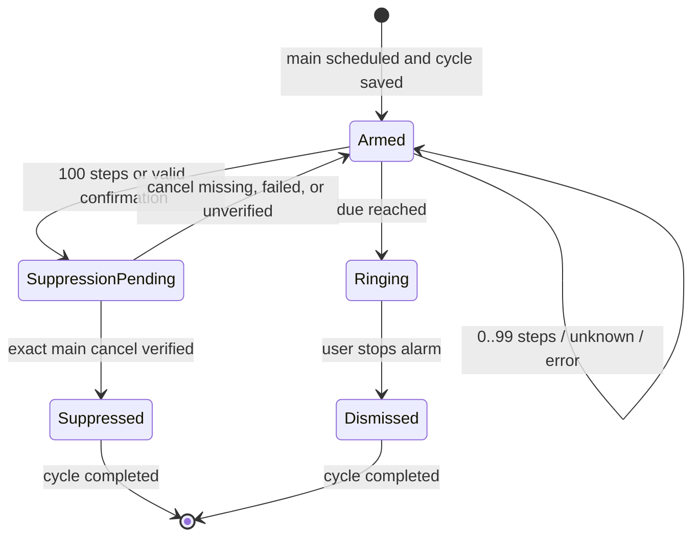

# AlreadyUp 設計

## 1. 目的と安全原則

AlreadyUp は、設定時刻に実際の音を鳴らし、期限前60分以内の100歩の起床行動または本人の明示操作を確認できた場合だけ、対応する1周期のアラームを抑止する。

> 起きていると確定できない場合は、アラームを残す。

最重大事故は「本当は寝ているのに、推定や処理失敗によってアラームを止めること」である。誤って鳴ることは許容しても、正の証拠と OS 上の取消確認なしに止めることは許容しない。

## 2. 現行スコープ

### 含む

- 最大10件のアラーム設定
- 今日だけ、毎日、平日、曜日指定
- 設定ごとのオン／オフと削除
- 各設定の先3周期を個別 local notification として予約
- 期限の60分前から数える foreground Pedometer の100歩
- 期限直前の actionable notification
- 対象周期だけを cancel する fail-safe policy
- foreground ループ音
- 就寝時の正式手順（アプリを開いたまま充電）と、鳴動中・24時間以内の監視周期がある間の画面スリープ防止（11.2）
- v1 単一アラーム保存形式から v2 複数形式への移行

### 含まない

- 睡眠そのものの推定
- background での継続的な歩数監視
- AlarmKit / Critical Alerts による鳴動保証
- スヌーズ
- アラーム名、音、振動の編集
- 先3周期をバックグラウンドで永続的に補充する native scheduler
- watchOS 専用アプリ

## 3. データモデル

### 3.1 Alarm definition

```ts
interface StoredAlarmDefinition {
  id: string;
  hour: number;
  minute: number;
  repeat: AlarmRepeat;
  enabled: boolean;
  createdAtMs: number;
  cycles: StoredAlarm[];
}

type AlarmRepeat =
  | { kind: 'today'; weekdays: []; dateKey: string }
  | { kind: 'daily'; weekdays: [0, 1, 2, 3, 4, 5, 6] }
  | { kind: 'weekdays'; weekdays: [1, 2, 3, 4, 5] }
  | { kind: 'custom'; weekdays: Weekday[] };
```

曜日はローカル timezone の `0=日` から `6=土` で保存する。`today` は日付を `YYYY-MM-DD` として固定し、過去時刻を翌日へ繰り越さない。

### 3.2 Alarm cycle

```ts
interface StoredAlarm {
  alarmId: string;
  cycleId: string;
  mainAlarmId: string;
  checkInNotificationId?: string;
  armedAtMs: number;
  dueAtMs: number;
  phase: 'armed' | 'step_candidate' | 'suppressed' | 'ringing' | 'dismissed';
  stepCount: number;
  stepCountFromMs?: number;
  stepCandidateAtMs?: number;
  confirmedAtMs?: number;
  stepCandidateRecorded: boolean;
}
```

`stepCount` は `stepCountFromMs` から数えた歩数である。`stepCountFromMs` がその周期の現在の歩数 window 開始時刻と一致しない場合（旧データで未設定の場合を含む）、保存済み `stepCount` は0として扱う。同じ開始時刻での更新は大きい方を保持し、異なる開始時刻での更新は新しい値で置き換えて `stepCountFromMs` も更新する。

`alarmId` はユーザー設定、`cycleId` は特定日の特定時刻を識別する。通知 action の `cycleId`、保存済み `mainAlarmId`、check-in request ID の全てが一致しない限り cancel しない。

## 4. 繰り返し計算

`getUpcomingAlarmTimes` はローカル date を1日ずつ進め、repeat rule に一致する未来時刻を最大3件返す。

| repeat | 次回計算 |
|---|---|
| 今日だけ | 保存した当日かつ現在より後だけ |
| 毎日 | 次に到来する全曜日 |
| 平日 | 月〜金だけ |
| 曜日指定 | 選択した1曜日以上だけ |

全て one-off `DATE` trigger とする。同じ recurring request を使わないのは、1周期だけを安全に cancel し、古い応答が将来周期へ波及することを防ぐためである。

## 5. 通知予算

iOS は保留 local notification を直近64件まで保持する。AlreadyUp は次の上限を固定する。

```text
10 alarm definitions
× 3 upcoming cycles
× 2 notifications (main + check-in)
= 60 pending notifications maximum
```

予約枠は JavaScript が動いている間だけ、次の契機で各設定の先3周期（`today` は1周期）まで補充する。

| 契機 | 条件 |
|---|---|
| 起動時の読み込み | 未完了の停止処理を回復できた場合。`prepareNotifications()` で必要なら権限を求める |
| `AppState` が `active` へ変化（読み込み完了後） | Web でない、別の補充が実行中でない、オンのアラームがある、`getPermissionsAsync()` が `granted`。権限 prompt は出さない（`prepareNotificationsIfGranted()`）。停止・オフの journal が残る definition は補充しない |
| アプリ内の起床確認成功・100歩抑止・鳴動停止 | 対象 definition だけ補充する |

起動時と `active` 復帰時は同じ補充処理を使い、補充途中で保存に失敗した場合は今回予約した通知を取り消す（`withScheduledNotificationRollback`）。予約できなかった問題は `kind` と `alarmId` で識別し、前回の補充で報告していない問題がある場合だけ notice を出す（`reconcileReportedScheduleProblems`）。問題が解消すると記録から外し、再発時は再び通知する。各行の予約範囲表示（11章）が状態を示し続けるため、同じ notice を復帰のたびに繰り返さない。

通知の「起きています」や通知からの停止だけを使い、アプリを前面に戻さない場合は補充されない。アプリを3周期以上開かない場合の継続補充は未実装であり、本番 release gate とする。暫定対策として、main 通知の本文に「アプリを開くと次回以降の予約を続けます。」を添え、一覧で予約の終わりと残り1周期を警告する。

## 6. 予約シーケンス

各周期は次の順序で予約する。

1. 入力時刻と repeat rule を検証する。
2. 一意な `cycleId` を作成する。
3. main alarm を OS に登録し、`mainAlarmId` を得る。
4. 最大60秒前の check-in を登録する。
5. definition と cycle を AsyncStorage v2 に保存する。

main を必ず先に登録する。check-in の登録に失敗しても main を残し、警告を返す。main の登録に失敗した周期は「予約済み」と表示しない。

## 7. 起床証拠と抑止

### 7.1 100歩

- foreground で最も近い未来周期だけを監視する。
- 歩数 window（2026-10-05決定）は `startMs = max(dueAtMs - 60分, armedAtMs, floorMs)` から `dueAtMs` 未満までとする。`floorMs` は他の周期（全設定）のうち `suppressed` かつ `confirmedAtMs < dueAtMs` の最新 `confirmedAtMs` であり、別周期の停止に使った歩数や確認済みの時間帯を再利用しない（例: 06:30 と 07:00 の設定）。一度保存した `stepCountFromMs` より window 開始を早めない。
- window 開始前は Pedometer を購読せず、数えない。window 中は保存済みの window 歩数、iOS では `getStepCountAsync(startMs, now)` の大きい方を起点に、即時に1回評価してから `watchStepCount` の増分を加える。履歴取得の失敗は保存済み歩数へ fallback する。
- 99歩以下は main を変更しない。
- 100歩以上でも `armedAtMs <= observedAtMs < dueAtMs` を満たさない場合は拒否する。
- 歩数証拠は数え始めた時刻 `countedFromMs` を持つ。`countedFromMs` が欠落・非有限、`dueAtMs - 60分` より前、`armedAtMs` より前、または `observedAtMs` より後の場合は `STEP_COUNT_OUTSIDE_WINDOW` で拒否する。
- 保存済み `mainAlarmId` を cancel し、OS pending 一覧から消えたことを確認した場合だけ `suppressed` にする。
- 別設定、別日、次の周期は変更しない。

### 7.2 明示確認

check-in notification の「起きています」は、次の全条件を満たす場合だけ有効である。

1. action identifier が `confirm_awake`。
2. kind が `awake_checkin`。
3. cycle、main request、check-in request が保存済み周期と一致。
4. 保存 phase が `armed` または `step_candidate`。
5. 確認時刻が check-in window 内かつ期限前。
6. main cancel 後、OS pending 一覧で消失を確認。

古い通知、default tap、重複 action、期限後 action、取消例外では main を残す。

## 8. 状態遷移



期限と証拠が同時に競合する場合はアラームを優先する。

## 9. 複数アラーム操作

### オフ

definition が持つ check-in と main を個別に cancel し、OS pending 一覧で消失を確認する。成功後に `enabled=false`、`cycles=[]` を保存する。確認できなければ設定を変更せずエラーを表示する。

### オン

repeat rule から先3周期を再計算し、新しい cycle ID と notification ID を発行する。過去になった「今日だけ」は再利用せず、新規作成を求める。

### 削除

確認ダイアログ後、対象 definition の通知だけを解除する。解除成功後に definition を削除する。

### 鳴動停止・起床確認後

`today` は無効化する。繰り返し設定は完了周期を残りの周期と区別し、予約枠を最大3件へ補充する。

## 10. 保存と移行

- v2 key: `already-up/alarm-definitions/v2`
- legacy key: `already-up/active-alarm/v1`
- v2 は `{ version: 2, alarms }` として保存する。
- ID 重複、時刻範囲、repeat rule、cycle shape、最大10件を load / save の両方で検証する。`stepCountFromMs` は任意項目で、存在する場合だけ有限の数値であることを検証する（未設定の旧データは有効）。
- 全ての read-modify-write は直列 mutation queue 内で最新値を読み直し、通知応答・歩数更新・画面操作・起動時補充が互いの保存結果を古い snapshot で上書きしない。
- v2 が存在せず valid な v1 がある場合、`today` definition 1件へ移行し、v2 保存成功後に v1 key を削除する。
- malformed data では推測復旧せず、予約済み通知を勝手に解除しない。

## 11. UI 契約

- 上部はブランド、画面タイトル、追加ボタンだけにし、prototype / presentation 表示を置かない。
- 次回アラームは時刻、日付、残り時間を表示する。歩数 window 開始前は進捗barを出さず「起床確認は HH:MM から」「アプリ表示中に100歩」と開始時刻を示し、window 中だけ「起床確認 N / 100歩」と進捗barを表示する。進捗は現在の window で数えた歩数だけを使う。
- 通常文字サイズでは有効時 / idleのsummary cardを同じ140pt固定高とし、一覧の開始位置を動かさない。Dynamic Typeのアクセシビリティscroll時だけ、文字を切らないため同じ140pt最小高から内容に応じて拡張する。
- 設定一覧は時刻、repeat label、次回日付、toggle、予約範囲、削除を表示する。予約範囲は `describeScheduleCoverage`（`src/scheduleCoverage.ts`）で、未来の `armed` / `step_candidate` 周期だけから求める。

  | `describeScheduleCoverage` | 行の表示 |
  |---|---|
  | `off`（オフ） | `通知は予約されていません` |
  | `none`（オンだが未来の監視周期がない） | `予約がありません`（警告色） |
  | `scheduled`（`isRunningLow = false`） | `{最後の周期の日付}まで予約済み`（例: `10/7(水)まで予約済み`） |
  | `scheduled`（`isRunningLow = true`。`today` 以外で残り1周期以下） | `{日付}まで予約済み・アプリを開くと先の分を予約します`（警告色） |

  日付は次回アラーム card と同じ `M/D(曜)` 形式とする。通知配送の警告中（11.1）は、オンの各行で予約範囲の代わりに配送できない理由を同じ警告色で表示する。
- メイン画面は通常文字サイズでは外側を `View` として viewport 内に固定し、ページ全体をスクロールさせない。アラーム一覧だけを独立した `ScrollView` とし、件数が増えた場合もヘッダー、次回アラーム、追加導線、一覧panelの丸い下端をviewport内へ固定する。
- Dynamic Type の `fontScale > 1.3` では情報欠落を避けるアクセシビリティ例外として外側スクロールを許可し、通常文字サイズでは一覧以外を固定する。
- 追加フォームはメイン画面の layout tree に挿入せず、背景を blur する `Modal` 上のサブ画面として表示する。タイトル直下の「時刻」「繰り返し」で内容を分け、選択中のglass lensをspring移動させる。通常端末（高さ700pt以上、幅360pt以上、`fontScale <= 1.3`）はsheet高を固定して内部スクロールを無効化し、繰り返しと100歩の説明も1画面内で操作できる。小さい画面・狭い画面・大きい文字では情報欠落を避けるためフォーム本体だけを内部スクロールし、repeat labelは2行まで許可する。
- 時刻設定の標準操作はnative pickerとする。iOSは「時刻」内の先頭に`display="spinner"`の216pt wheelを常時表示し、選択帯を含めて角丸surface内にclipする。Androidは公式推奨のimperative APIで`display="clock"` dialogを開く。選択時刻と`数字で入力`はpicker後段のsecondary controlとし、表示時刻をタップした場合だけ時・分のnumeric keyboard inputへ切り替える。入力は`0..23` / `0..59`を確定時に検証し、不正値では親のalarm stateを更新しない。編集中はpickerを閉じて追加CTAと「繰り返し」切替を無効化する。`fontScale > 1.3`では横並びcopyを縦積みにする。
- 状態通知はstatus barの下、brand rowより上のabsolute overlay layerへspring表示し、メインlayoutを押し下げない。上端のdrag handleでgestureを示し、閉じるbuttonに加えて、上方向へ32px以上または十分な上向き速度でswipeするとdismissし、未達gestureは元の位置へ戻す。Reduce Motion時は自動springを無効化する。
- 追加エラーはスクロール領域外の固定footerに表示し、custom曜日未選択のようなdisabled理由は表示中のtabにかかわらず常時示す。dangerはassertive、その他の状態通知はpoliteとしてassistive technologyへ通知する。ただし頻繁なalarm toggleは完全成功時のbannerを出さない。例外による失敗はdanger、アラーム本体を保存できても一部の起床確認通知を予約できなかった場合だけwarningを表示する。追加処理中はtab、picker、repeat、曜日、確定操作をすべて無効化する。
- iOS 26 以降は `expo-glass-effect` の native Liquid Glass を使う。旧iOSとWebは `expo-blur`、Androidは既存UIの見た目と負荷を維持するため、SDK更新後も半透明 surfaceへfallbackする（`blurMethod="none"`）。Reduce Transparency 有効時はsemantic stateを保った不透明度の高い surface に切り替える。
- Glassは背景写真と操作面の関係を示す上部summary、追加、通知、時刻編集、選択lens、確定へ限定する。alarm list panelと各alarm cardは読みやすいstandard materialを維持し、大面積の背景全体を一律に透明化しない。
- 追加フォームの「時刻／繰り返し」とrepeat controlは、それぞれ1つのglass lensを選択肢間でspring移動させ、単なる背景色の切替にしない。native GlassView自体のopacityはanimateせず、wrapperのgeometryを移動する。Reduce Motion時は選択位置を即時更新する。
- Glass surface 上でも本文・操作のコントラストを維持し、tintは主操作・選択・statusの意味がある箇所だけに使う。glass-on-glassを避ける。
- ホーム背景は端末のローカル時刻とtimezoneだけから決定し、同一の湖畔景観をphotorealisticに生成した夜明け、昼、夕暮れ、夜の4 assetを連続cross-fadeする。基準の日の出は06:00、日の入りは18:00とし、codeで星、太陽、月、山を描くillustration layerは使わない。背景はdecorativeとしてaccessibility treeから除外し、上部scrimでstatus barとheaderの白文字contrastを維持する。
- 背景assetのopacity計算は純粋関数に分離し、任意時刻で隣接する最大2 assetだけを合計opacity 1でblendする。React Nativeの`Image`もopacityが0より大きい最大2枚だけをmountし、4枚同時decodeを避ける。位置情報、国籍、networkは現行モデルへ入力しない。実地点・季節の日の出時刻を使う拡張は、任意の位置情報権限、手動地域設定、privacy copyを別途承認してから追加する。
- Web は UI smoke test とし、通知操作を disabled にする。

### 11.1 通知配送状態

background / terminated でアラームを鳴らせるのは OS の local notification だけであるため、通知権限から配送状態 `NotificationDeliveryState` を判定し（`src/notificationDelivery.ts`）、鳴らない可能性がある間は「設定済み」に見える表示をしない。判定できない場合は `unknown` とし、`ok` とみなさない。

| `getPermissionsAsync()` の結果 | 状態 |
|---|---|
| 結果なし（`null` / `undefined`） | `unknown` |
| iOS `status` 0（NOT_DETERMINED）/ 1（DENIED） | `off` |
| iOS `status` 3（PROVISIONAL。通知センターへ静かに配送） | `silent` |
| iOS `status` 2（AUTHORIZED）/ 4（EPHEMERAL）かつ `allowsSound === false` | `silent` |
| iOS `status` 2 / 4（上記以外） | `ok` |
| iOS `status` がそれ以外の値 | `unknown` |
| `ios` なし（Android） | `granted` なら `ok`、それ以外は `off` |
| 取得時の例外 | `unknown` |

確認のライフサイクル:

| 契機 | 動作 |
|---|---|
| 起動直後（読み込み完了前） | 状態は `null`（未確認）。警告しない |
| 起動時の読み込み完了後 | `getPermissionsAsync()` で確認する（prompt は出さない） |
| `AppState` が `active` へ変化 | 再確認する。設定アプリから戻った時の復旧と、設定後の無効化を検知する |
| アラームの追加・オン操作の終了後 | 成功・失敗とも再確認する（権限 prompt の結果を反映） |
| Web | 確認しない（`null` のまま） |

警告は「状態が `ok` 以外」かつ「オンのアラームが1件以上」の場合だけ表示する（`shouldWarnNotificationDelivery`）。

| 状態 | summary card（鳴動中でない場合） | オンの各行 |
|---|---|---|
| `ok` | 通常の次回アラーム / idle card | 予約範囲（11章。例: `10/7(水)まで予約済み`） |
| `off` | 「通知がオフです」「次のアラーム {日付} {時刻} は、アプリを閉じていると鳴りません。」 | `通知オフ・アプリを閉じると鳴りません` |
| `silent` | 「通知の音がオフです」「…アプリを閉じていると音が出ません。」 | `通知音オフ・アプリを閉じると音が出ません` |
| `unknown` | 「通知の状態を確認できません」「…鳴るか確認できません。」 | `通知の状態を確認できません` |

- 警告 card は次回アラーム card を置き換える danger 状態であり、閉じられない。配色は鳴動 card の danger tone を流用し、Dynamic Type で文言を切らないため140pt最小高から拡張する。
- 次回周期がない場合（オンだが予約なし）も、日付を除いた文言で警告する。
- `設定を開く`（`accessibilityRole="button"`、44pt以上）は `Linking.openSettings()` を呼ぶ。Expo Go では Expo Go の設定画面が開く。失敗時は danger notice を出す。
- foreground では端末内のループ音で鳴るため、`off` / `silent` の文言は「アプリを閉じていると」に限定し、常に鳴らないとは表示しない。
- 鳴動中は鳴動 card を優先し、各行の警告だけを表示する。
- 配送状態はアラーム周期の状態を変更しない。`off` でも予約・保存済み周期を解除しない。

### 11.2 就寝時の表示と画面スリープ防止（2026-10-05決定）

Expo Go 配布のままでは、アプリを閉じる・画面がロックされると、アラームは main 通知の通知音1回だけになり、ループ音と歩数確認は動かない。owner 決定（2026-10-05）により、当面は「アプリを画面に表示したまま充電して寝る」ことを正式手順とし、監視中は画面を消さない。本番は自前ビルド（native alarm / AlarmKit 等）へ移行する（ALR-001）。配布方式と native config は変更しない。

画面スリープ防止の条件は純粋関数 `shouldKeepScreenAwake(alarms, nowMs)`（`src/bedsideMode.ts`）で判定する。

| 状態 | 画面を消さない |
|---|---|
| いずれかの周期が `ringing`（定義の `enabled` は問わない。鳴動 card とループ音が `enabled` に依存しないため） | する |
| オンの定義に `armed` / `step_candidate` 周期があり、`dueAtMs <= now + 24時間`（`KEEP_AWAKE_LOOKAHEAD_MS`。ちょうど24時間後を含む） | する |
| 上記のうち期限を過ぎた監視周期（1秒 tick で `ringing` へ移る直前） | する（移行前に画面が消えてアプリが止まるのを防ぐ） |
| オンの監視周期が24時間より先だけ、オフの定義だけ、停止済み（`suppressed` / `dismissed`）周期だけ、アラームなし | しない（端末の自動ロック設定に従う） |

ライフサイクル（`App.tsx`）:

- 条件が true かつアプリが前面にある間だけ `activateKeepAwakeAsync('already-up/bedside')` を呼び、条件が false になった時・前面でなくなった時・unmount 時に同じ tag で `deactivateKeepAwake` を呼ぶ。他の keep-awake 利用（Expo の開発用 tag など）とは tag で分離する。
- 前面の判定は `isForegroundAppState`。`background` だけを前面外とし、`active`、`inactive`（iOS の Control Center 表示・着信 overlay 中など）、読み取れない状態は前面とみなす。誤って画面を消すより、画面を点けたままにする方を安全側とする。`active` に戻るたびに再取得する。
- Web では呼ばない。activate の失敗はアプリを止めず、warning notice「画面を点けたままにできませんでした。画面が消えるとアラームは通知音1回だけになるため、端末の自動ロックをオフにしてください。」を表示する。deactivate の失敗は無視する。
- 画面の明るさは変更しない。手動ロック、ほかのアプリへの切替、着信などによる中断は防げない。

就寝案内 footer:

- メイン画面の最下部（一覧 panel の下）に、通常文字サイズ・小さい画面（iPhone SE の667pt を含む）・大きい文字のいずれでも常に表示する。1行目「寝るときはアプリを開いたまま充電してください」（12pt / 700）、2行目「閉じると通知音1回だけ・歩数確認なし」（11pt / 600）とし、11pt 未満にしない。文言は `BEDSIDE_GUIDANCE` に置き、追加フォームの100歩の説明にも同じ文言を1行追加する。
- footer 全体を1つの accessibility 要素とし、2行をつないだ label を読み上げる。`allowFontScaling` を有効にし、`maxFontSizeMultiplier` は2とする（`fontScale > 1.3` では画面全体がスクロールするため、それ以上の拡大で一覧を圧迫しない）。幅が足りない場合は省略せず折り返す。
- 背景写真の上に自前の backdrop（`rgba(6, 21, 45, 0.86)`、角丸12pt）を敷き、文字は `#FFFFFF` / `#C5CDD8` とする。写真が白・黒のどちらでも 4.5:1 以上のコントラストを保つことを unit test で確認する（`BEDSIDE_FOOTER_COLORS`）。
- 高さが足りない画面では footer を隠さず、`flex: 1` の一覧 panel が縮む。一覧は内部スクロールで全件に到達できる。

## 12. Platform 制約

| 制約 | 現行動作 |
|---|---|
| Pedometer background 非対応 | 起床確定にせず main を残す |
| 歩数監視 window（2026-10-05決定） | 最も近い未来周期を、期限の60分前から foreground 中だけ監視する。前夜・日中の歩数と他周期の停止に使った歩数は数えない。background / terminated 中の判定は未対応で、確認できなければ main を残す |
| アプリを閉じる / 画面ロック（Expo Go） | main 通知の通知音1回だけ。ループ音・歩数確認なし。就寝時はアプリを開いたまま充電する手順とし、表示中は鳴動中・24時間以内の監視周期がある間だけ画面を消さない（11.2）。手動ロック・アプリ切替は防げない |
| 通知権限拒否 | 新規アラームを追加しない。既存のオンのアラームは解除せず、summary を閉じられない警告へ置き換え、各行に通知オフを表示する（11.1） |
| 通知音オフ / provisional | 予約は維持し、`silent` 警告を表示する（11.1） |
| 消音スイッチ / 音量 / Focus / Android の channel 単位の音設定 | 検出しない。`ok` 表示でも鳴動保証はない |
| check-in 登録失敗 | main を残し警告 |
| main 登録失敗 | 周期を保存しない |
| cancel 未確認 | `suppressed` にしない |
| Focus / 消音 / 音量 | 鳴動保証なし。release gate で扱う |
| app terminated 時の action | JS handler 不実行の可能性。main が残る安全側 failure |
| 3周期を越える未起動 | 追加周期が補充されない |
| production app identity 未確定 | `app.alreadyup.prototype` を維持し、人間承認なしに app identity を変更しない |
| Web native time picker非対応 | dialはExpo Go実機で使用する旨を表示し、UI / bundle smokeだけ行う |

## 13. Verification matrix

| ID | シナリオ | 期待結果 |
|---|---|---|
| POL-01 | 99歩 | 対象 main を維持 |
| POL-02 | 期限前100歩 + cancel verified | 対象周期だけ suppress |
| POL-03 | 期限時100歩 | main 優先 |
| POL-04 | 古い cycle action | 現周期を維持 |
| POL-05 | 前夜21:00から数えた100歩で07:00を評価 | `STEP_COUNT_OUTSIDE_WINDOW` で main を維持 |
| POL-06 | 06:00（60分前ちょうど）から数えた100歩 | 07:00 周期だけ suppress |
| POL-07 | window 開始の1ms前から数えた歩数、または翌日周期へ同じ歩数を適用 | 拒否して main を維持 |
| POL-08 | window 内に予約された周期 | `armedAtMs` から数え、それより前の歩数は拒否 |
| POL-09 | 06:30 を 06:10 に停止した後の 07:00 | 06:10 以降の歩数だけを数える |
| POL-10 | window 開始と異なる `stepCountFromMs` の保存歩数 | 0 から数え直す。同じ開始時刻なら大きい方を保持 |
| POL-11 | window 開始前 | Pedometer を購読せず、開始時刻を表示する |
| REP-01 | 毎日 | 次の3日を計算 |
| REP-02 | 金曜の平日設定 | 月・火・水を計算 |
| REP-03 | 過去の今日だけ | 翌日へ繰り越さず拒否 |
| MUL-01 | 2設定の片方を suppress | 他方の IDs は不変 |
| MUL-02 | toggle off | 対象 definition の通知だけ解除 |
| MUL-03 | delete | 対象 definition だけ削除 |
| UI-01 | アラームをoff / on | summary card高と一覧開始位置が変わらない |
| UI-02 | noticeを短く上swipe | bannerは元位置へ戻る |
| UI-03 | noticeを32px以上または高速で上swipe | bannerをdismiss |
| UI-04 | iOS wheel / Android clock | 選択時刻が親formへ反映 |
| UI-05 | 表示時刻をタップ | keyboard direct inputへ切り替え |
| UI-06 | 通常端末で追加フォームの「時刻／繰り返し」を切替 | sheetとfooterが動かず、内容領域はスクロールしない |
| UI-07 | iOS wheelの選択帯 | 216pt wheelを縦に欠けさせず、横方向は角丸surface内に収まる |
| UI-08 | 高さ700pt未満、幅360pt未満、または`fontScale > 1.3` | フォーム本体だけがスクロールし、全操作へ到達できる |
| UI-09 | 02:00 / 06:00 / 12:00 / 18:00 / 21:00のlocal time | phaseとnight / dawn / day / dusk写真weightが期待する状態になる |
| UI-10 | 23:59:59から00:00:00へ遷移 | night写真weightが不連続に飛ばない |
| UI-11 | alarm toggle完全成功 / 部分予約失敗 / 例外失敗 | 完全成功時はbannerなし、部分予約失敗時はwarning、例外失敗時はdanger noticeを表示する |
| NTF-01 | iOS 未決定・拒否 / provisional / 許可＋音オフ / 許可 / 未知の status / 結果なし | `off` / `silent` / `silent` / `ok` / `unknown` / `unknown` |
| NTF-02 | `ok` 以外でオンのアラームあり | 閉じられない警告 card と各行の警告を表示し、「次のアラーム」「…まで予約済み」を表示しない |
| NTF-03 | オフのアラームだけ、アラームなし、または未確認（`null`） | 警告しない |
| NTF-04 | 設定アプリで通知をオフにしてアプリへ戻る / オンに戻して戻る | `active` で再確認し、警告を表示 / 通常表示へ戻す（実機確認が必要） |
| SCH-01 | オフ / オンで未来の監視周期なし / 3周期 / 繰り返しで残り1周期 / `today` で残り1周期 | `off` / `none` / `scheduled`（最後の期限） / `isRunningLow` / `isRunningLow` ではない。期限を過ぎた周期と鳴動・停止済み周期は数えない |
| SCH-02 | 通知からの停止だけで2周期進めた後にアプリへ戻る（権限あり） | `active` で先3周期まで補充し、行が「…まで予約済み」に戻る（実機確認が必要） |
| SCH-03 | 権限なしでアプリへ戻る | 補充も権限 prompt も行わない |
| SCH-04 | 同じ予約失敗が続く状態でアプリへ繰り返し戻る | notice は最初の1回だけ。解消後の再発は再通知する |
| BED-01 | 鳴動中（オフの定義を含む） / オンで23時間59分後・ちょうど24時間後の監視周期 / 期限を過ぎた監視周期 / `step_candidate` | `shouldKeepScreenAwake` が true |
| BED-02 | アラームなし / オフの定義だけ / 24時間より1ms以上先だけ / `suppressed`・`dismissed` だけ | false |
| BED-03 | `AppState` が `background` / `active` / `inactive` / 不明 | `background` だけ画面スリープ防止を解除する |
| BED-04 | 就寝案内 footer の文字色 | 背景写真が白・黒のどちらでも 4.5:1 以上 |
| BED-05 | Expo Go 実機で一覧を表示したまま、自動ロック時間を過ぎるまで待つ | 24時間以内にオンのアラームがあれば画面が消えない。すべてオフにする・停止後に24時間より先だけになると自動ロックに戻る（実機確認が必要） |
| BED-06 | iPhone SE（667pt）を含む画面高、Dynamic Type 標準〜最大 | footer が常に表示され、一覧 panel が縮む。文字を省略せず、画面からはみ出さない（実機確認が必要） |

## 14. 参照資料

- [Expo Notifications — SDK 57](https://docs.expo.dev/versions/v57.0.0/sdk/notifications/)
- [Expo Pedometer — SDK 57](https://docs.expo.dev/versions/v57.0.0/sdk/pedometer/)
- [Expo KeepAwake — SDK 57](https://docs.expo.dev/versions/v57.0.0/sdk/keep-awake/)
- [Expo DateTimePicker — SDK 57](https://docs.expo.dev/versions/v57.0.0/sdk/date-time-picker/)
- [Expo LinearGradient — SDK 57](https://docs.expo.dev/versions/v57.0.0/sdk/linear-gradient/)
- [React Native 0.86 PanResponder](https://reactnative.dev/docs/0.86/panresponder)
- [Apple: Scheduling a notification locally](https://developer.apple.com/documentation/usernotifications/scheduling-a-notification-locally-from-your-app)
- [Apple: UILocalNotification pending limit](https://developer.apple.com/documentation/uikit/uilocalnotification)
- [Apple Watch notifications](https://support.apple.com/guide/watch/notifications-apd9b833c9f3/watchos)
